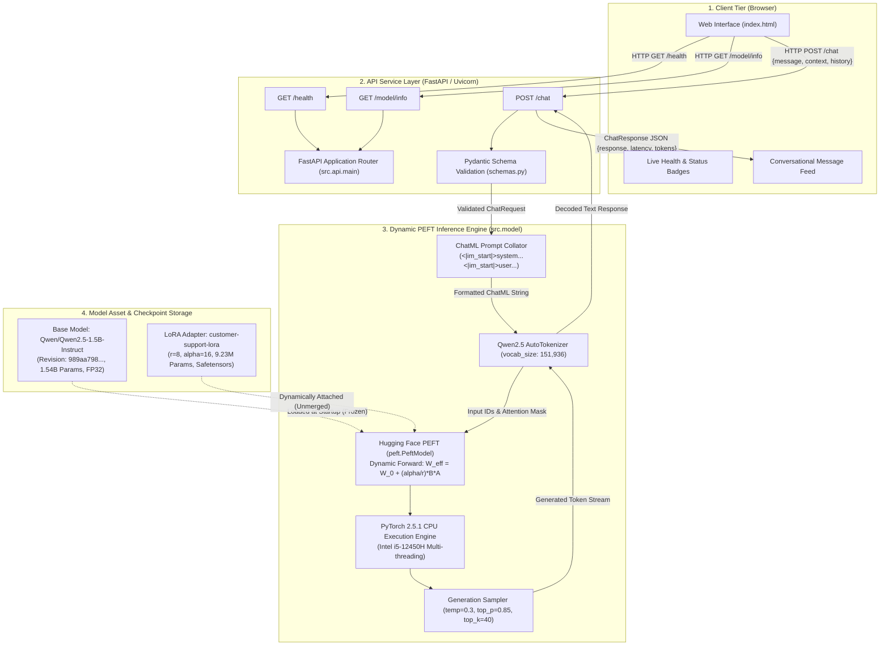
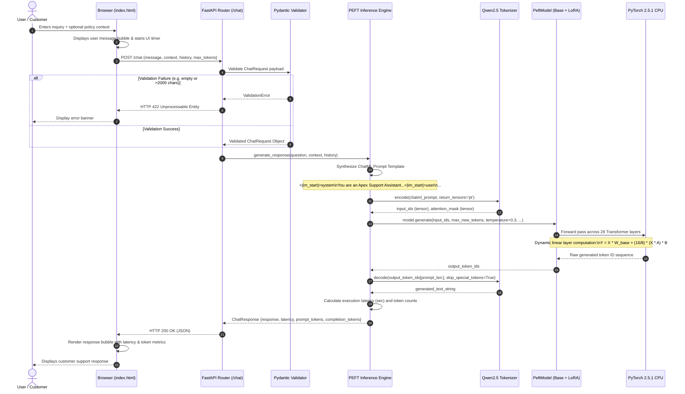

# System Architecture & Data Flow Blueprint

**Project:** SLM-Powered Customer Support Assistant  
**Repository:** `C:\slm-customer-support`  
**Base Model:** `Qwen/Qwen2.5-1.5B-Instruct` (Revision: `989aa7980e4cf806f80c7fef2b1adb7bc71aa306`)  
**Adapter:** `customer-support-lora` (SHA-256: `5d70525e3f51b7a8da4356a3d24a8221f9842f9fb596766bd5e4d386e0e411a6`)  
**Document:** End-to-End Architectural Specification  

---

## 1. Architectural Overview & Component Boundaries

The system is organized into five strictly decoupled architectural tiers:
1. **Frontend Client Tier:** Single-page responsive web console providing real-time telemetry and conversational interface.
2. **FastAPI Web Service Layer:** Asynchronous REST API managing lifecycle events, request validation, and routing.
3. **Prompt Engineering & Collator Layer:** ChatML formatting, system instruction synthesis, and conversation history collation.
4. **Hugging Face PEFT Dynamic Engine:** Dynamic low-rank decomposition ($W = W_0 + \frac{\alpha}{r} B A$) executing on PyTorch CPU without weight merging.
5. **Model Storage & Checkpoint Tier:** Pinned, immutable base model weights in Hugging Face cache and verified LoRA safetensors on disk.

---

## 2. End-to-End Request Lifecycle & Sequence Flow

When a user submits a customer support inquiry, the system processes the request through the following sequence:

---

## 3. Deep Component Differentiation

### 3.1 Base Model (`Qwen/Qwen2.5-1.5B-Instruct`)
- **Role:** Foundational linguistic, grammatical, and reasoning substrate.
- **Parameters:** 1,543,714,304 parameters across 28 transformer decoder blocks.
- **State in Memory:** Loaded in full 32-bit floating point precision (`torch.float32`) on CPU. All parameters have `requires_grad = False` and are completely frozen.
- **Storage:** Stored immutably inside the user's local Hugging Face snapshot cache (`~/.cache/huggingface/hub/models--Qwen--Qwen2.5-1.5B-Instruct/snapshots/989aa7980e4cf806f80c7fef2b1adb7bc71aa306`).
- **Cryptographic Immutability:** Locked to git commit hash `989aa7980e4cf806f80c7fef2b1adb7bc71aa306`.

### 3.2 LoRA Adapter (`customer-support-lora`)
- **Role:** Domain-specific parameter delta adaptation for retail customer support dialogues.
- **Parameters:** Exactly 9,232,384 parameters (0.5945% of base model size).
- **Decomposition:**
  For each targeted linear weight matrix $W_0 \in \mathbb{R}^{d \times k}$, low-rank matrices $A \in \mathbb{R}^{r \times k}$ and $B \in \mathbb{R}^{d \times r}$ are learned, where $r=8$ and scaling factor $\frac{\alpha}{r} = \frac{16}{8} = 2.0$.
- **Target Modules:** All 7 projection layers in the self-attention and MLP blocks:
  - Attention: `q_proj`, `k_proj`, `v_proj`, `o_proj`
  - Feed-Forward (MLP): `gate_proj`, `up_proj`, `down_proj`
- **File Provenance:** Stored in [`exports/customer-support-lora/adapter_model.safetensors`](../../exports/customer-support-lora/adapter_model.safetensors) (36,981,072 bytes, SHA-256: `5d70525e3f51b7a8da4356a3d24a8221f9842f9fb596766bd5e4d386e0e411a6`).

### 3.3 Dynamic PEFT Runtime (Unmerged Inference)
- **Mechanism:** Implemented via Hugging Face `peft.PeftModel.from_pretrained()`.
- **Dynamic Forward Computation:**
  Unlike static weight merging (which permanently alters $W_0$ into $W_{\text{merged}} = W_0 + \Delta W$), PEFT intercepts every targeted linear module call during the forward pass:
  $$h = W_0 x + \left(\frac{\alpha}{r}\right) B (A x)$$
- **Benefits:**
  1. Base model weights remain pristine and unmodified on disk and in memory.
  2. Zero quantization or conversion loss from intermediate exports.
  3. Enables multi-tenant serving where distinct domain adapters (e.g., technical support, billing, logistics) share a single base model instance.

### 3.4 FastAPI Service & Web Interface
- **FastAPI Framework:** Implements non-blocking asynchronous request dispatch with complete Pydantic contract validation.
- **REST Endpoints:**
  - `GET /health`: System health status, memory footprint, and device telemetry.
  - `GET /model/info`: Full model provenance, adapter checksum verification, and LoRA hyperparameters.
  - `POST /chat`: Primary customer support inference endpoint with token counting and latency telemetry.
  - `GET /`: Serves the single-page chat user interface.
- **Frontend Architecture:** Vanilla JavaScript/CSS single-page application requiring no external build tools, npm packages, or third-party CDNs. Features automatic polling of `/health` and live status pills.

---

## 4. Hardware & CPU Execution Profile

### 4.1 Memory Footprint on Windows 11
- **Total Physical RAM:** 15.70 GB DDR4.
- **Operating System + Background Services:** ~7.2 GB.
- **Application Process Footprint (Uvicorn + PyTorch + Qwen2.5-1.5B FP32 + PEFT):** ~6.4 GB resident memory.
- **Total In-Use Memory During Serving:** **13.61 GB** (~86.7% utilization).
- **Available System Headroom:** ~2.1 GB free RAM, guaranteeing zero swapping to disk or pagefile thrashing.

### 4.2 CPU Multi-Threading Execution
- **Processor:** Intel Core i5-12450H (8 Cores: 4 Performance Cores, 4 Efficient Cores, 12 Threads).
- **Instruction Sets Utilized:** AVX2, FMA3, and OpenMP multi-threaded GEMM kernels inside PyTorch `torch.ops.aten`.
- **Inference Latency Profile:**
  - TTFT (Time to First Token): ~1.2–2.0 seconds.
  - Inter-token Latency: ~350–480 ms per token (~2.1–2.8 tokens/second).
  - Typical Query Latency (35–40 tokens): **12.86s to 19.22s**.
